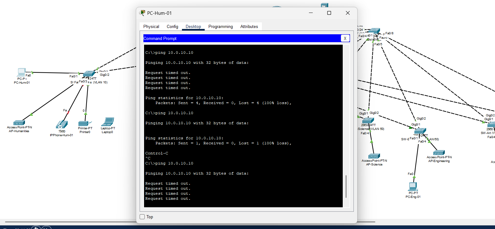

# Matadors University: secure campus network design

A complete three-tier campus network for a fictional university of **8 colleges** (about **2,568 devices**, wired and Wi-Fi), designed under a **$200,000** budget and built and validated in **Cisco Packet Tracer**.

*IS457 Advanced Telecommunications and Networking, California State University, Northridge (CSUN), spring 2026.*

## Architecture

```
            Internet (simulated)
                    |
              [ ASA 5506-X ]                  perimeter firewall, NAT
                    |
              [ ISR 4331 ]                    inter-VLAN routing (router-on-a-stick), DHCP, ACLs
                    |
       [ Dist-SW-1 ] === [ Dist-SW-2 ]        distribution: Rapid PVST+, EtherChannel
       /  /  /  /  \  \  \  \
     [ 8 access switches, dual-homed ]        one per college (2960-24TT)
       |        |
     PCs   APs / IP phones / printers
```

- **Segmentation**: one VLAN and one subnet per college (VLANs 10 to 80, 10.0.0.0/16).
- **Redundancy**: dual-homed access switches, two distribution switches as primary and backup root bridges, static EtherChannel between them.
- **Security in 4 layers**: ASA firewall with NAT at the edge, inter-VLAN ACLs, port-security on access ports, device hardening (SSH only, enable secret, unused ports disabled).
- **Wi-Fi**: one WPA2 SSID per college; **voice**: IP phone daisy-chained with a PC (voice VLAN, QoS trust).

## IP addressing plan

| College | VLAN | Subnet | Gateway | DHCP range |
|---|---|---|---|---|
| Humanities | 10 | 10.0.0.0/23 | 10.0.1.254 | .100 to .253 |
| Business | 20 | 10.0.2.0/23 | 10.0.3.254 | .100 to .253 |
| Social Sciences | 30 | 10.0.4.0/23 | 10.0.5.254 | .100 to .253 |
| Education | 40 | 10.0.6.0/23 | 10.0.7.254 | .100 to .253 |
| Science & Math | 50 | 10.0.8.0/23 | 10.0.9.254 | .100 to .253 |
| Engineering | 60 | 10.0.10.0/23 | 10.0.11.254 | .100 to .253 |
| Art & Media | 70 | 10.0.12.0/23 | 10.0.13.254 | .100 to .253 |
| Health & Human | 80 | 10.0.14.0/24 | 10.0.14.254 | .100 to .253 |

Static range `.1` to `.99` for servers, printers and infrastructure. Router to ASA: `10.255.255.0/30`; ASA to Internet: `200.0.0.0/30`.

## Validation

**16 tests, all passed** (detailed in the [report](docs/report.pdf)). A few of them:

| Test | Proof |
|---|---|
| Ping inside a VLAN | [test1_intra_vlan_ping.png](tests/test1_intra_vlan_ping.png) |
| Ping between VLANs, allowed | [test2_inter_vlan_allowed.png](tests/test2_inter_vlan_allowed.png) |
| Ping Humanities → Engineering, **blocked by ACL** | [test3_acl_blocked.png](tests/test3_acl_blocked.png) |
| Port-security (max 2 MAC addresses): a violation shuts the port down | [port_security.png](tests/port_security.png) |
| RSTP: Dist-SW-1 is root bridge, EtherChannel up | [test7_rstp_root_bridge.png](tests/test7_rstp_root_bridge.png) |



## Budget

**$142,616** for the whole design (71% of the $200,000 cap), leaving a $57,384 contingency, mainly thanks to refurbished enterprise hardware.

## Limits (what a real deployment would add)

- Some single points of failure remain (one router, one firewall).
- No 802.1X: port-security only; no central authentication (AAA / RADIUS) or logging (syslog / SIEM).
- No protection against layer-2 attacks such as DHCP snooping or Dynamic ARP Inspection.
- Some features (port-security, IP phone) are demonstrated on representative colleges, not replicated on all eight.

Demo credentials are set inside the `.pkt` file for lab use only.

## Files

- `matadors-campus.pkt`: the full network (open with Cisco Packet Tracer 8.x)
- `docs/report.pdf`: design report (20 pages)
- `docs/presentation.pdf`: final presentation
- `tests/`: validation screenshots

## Team

| Member | Role |
|---|---|
| **Bounam Aphayavong** | Architecture lead: network design and Packet Tracer build |
| Arianna Morales | IP addressing and VLAN design |
| Dylan Colazo Douriet | Routing and security |
| Harrison Argueta | Budget and documentation |
